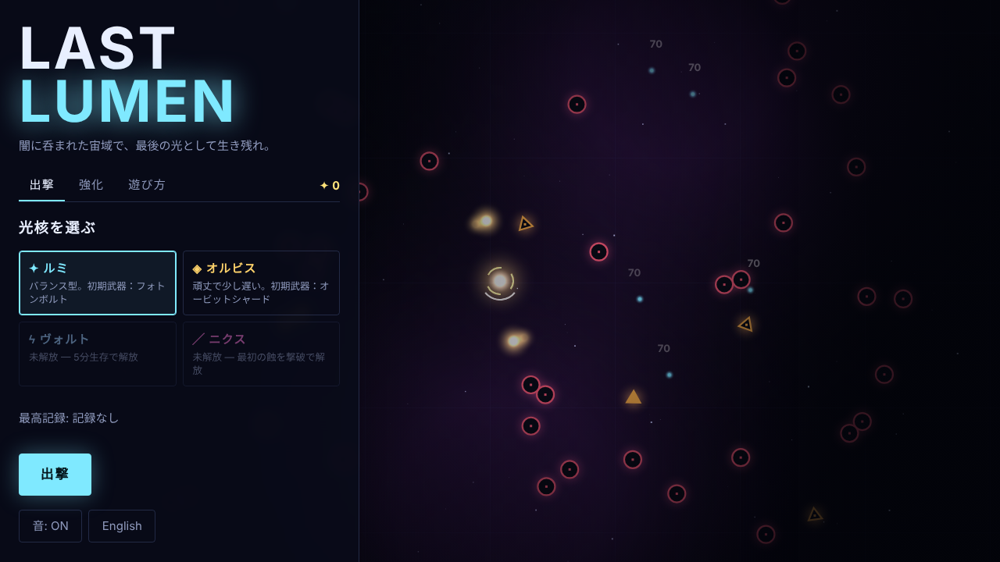
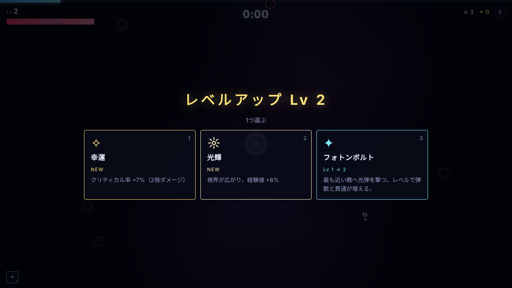

# LAST LUMEN（ラスト・ルーメン）

闇に呑まれた宙域で、最後の光として生き残るローグライト・サバイバーアクション。
ブラウザだけで動きます。依存ライブラリなし、ビルド不要、画像・音声ファイルもゼロ（描画はCanvas、音はWebAudioでその場で合成）。




## 遊び方

| 操作 | キーボード | タッチ | ゲームパッド |
| --- | --- | --- | --- |
| 移動 | WASD / 矢印キー | 画面をドラッグ | 左スティック |
| ダッシュ（一瞬無敵） | Space / Shift | DASHボタン | A / B / RT |
| 一時停止 | Esc / P | 右上のボタン | Start |
| 強化を選ぶ | 1・2・3（引き直しはR） | タップ | — |

- 攻撃は自動。敵が落とす光の欠片を集めてレベルを上げ、武器とパッシブを選んで育てます。
- 3分ごとにボス「蝕」が出現。4体倒すと夜明け（クリア）。その後はエンドレスで続行できます。
- 出撃のたびに星屑が手に入り、タイトルの「強化」で永続アップグレードを買えます。
- 条件を満たすと新しい光核（キャラクター）が解放されます。
- 出撃の途中経過は自動で保存されます。タブを閉じても、タイトルの「つづきから」で同じ場面から再開できます（一時停止メニューの「中断してタイトルへ」でも保存）。保存先は遊んだ端末のブラウザで、端末ごとに別々です。
- 出撃ごとにスコア（生存時間×10＋撃破×5＋レベル×50＋ボス撃破×3000）が付き、上位10件がタイトルの「ランキング」に残ります。プレイヤー名も付けられます。記録はそのブラウザ内に保存されます。

## 中身

- **武器 8種**（各Lv6まで）：フォトンボルト / オービットシャード / ノヴァパルス / アークチェイン / プリズムランス / スターフォール / シーカードローン / ヘイローマイン
- **パッシブ 9種**（各Lv5まで）、同時に持てるのは武器5・パッシブ5
- **敵 7種＋エリート＋ボス**（弾幕・突進・召喚の3フェーズ、撃破ごとに強化）
- **光核 4体**（うち2体は解放制）、**永続強化 7種**
- 時間経過と戦況で厚みが変わる**自動生成BGM**
- 日本語 / English 切り替え、スマホ・タブレット対応、セーブはブラウザの localStorage

## 動かす

ESモジュールを使っているので、ファイルを直接開くのではなく簡易サーバー経由で開きます。

```sh
npm start          # = python3 -m http.server 8080
# → http://localhost:8080
```

### GitHub Pagesで公開

リポジトリの **Settings → Pages → Source** を **GitHub Actions** にするだけです。
`main` へのpushごとに `.github/workflows/pages.yml` がテストを実行し、通れば公開します。

### 1ファイルにまとめる（任意）

```sh
node tools/bundle.mjs   # dist/last-lumen.html ができる（ダブルクリックで遊べる）
```

## テスト

```sh
npm test
```

シミュレーション（`src/game.js`）はDOMに一切触れないので、Node上でそのまま動きます。
テストではボット（`src/bot.js`、タイトル画面のデモプレイと共用）に全キャラクターで実際にプレイさせ、
数値が壊れないこと・同じシードで同じ結果になること・全武器がダメージを出すこと・
15分のプレイが実時間よりはるかに速く計算できることを確認しています。

## 構成

```
index.html / style.css   画面とスタイル
src/game.js              シミュレーション本体（武器・敵・ボス・成長）
src/data.js              調整値とテキスト（日英）— バランス調整はここ
src/render.js            Canvas描画（発光スプライト、パーティクル、暗闇）
src/audio.js             効果音と自動生成BGM
src/input.js             キーボード / タッチ / ゲームパッド
src/main.js              ループ、メニュー、HUD、セーブ
src/ranking.js           ランキングの並び替えルール
src/bot.js               自動操縦
test/sim.test.mjs        ヘッドレステスト
```

## English

LAST LUMEN is a roguelite survivor game for the browser: no dependencies, no build step, no asset files.
Move with WASD or by dragging, dash with Space, collect shards, pick upgrades, and defeat four Eclipses.
Run `npm start` and open http://localhost:8080. Run `npm test` for the headless simulation tests.

## License

MIT
